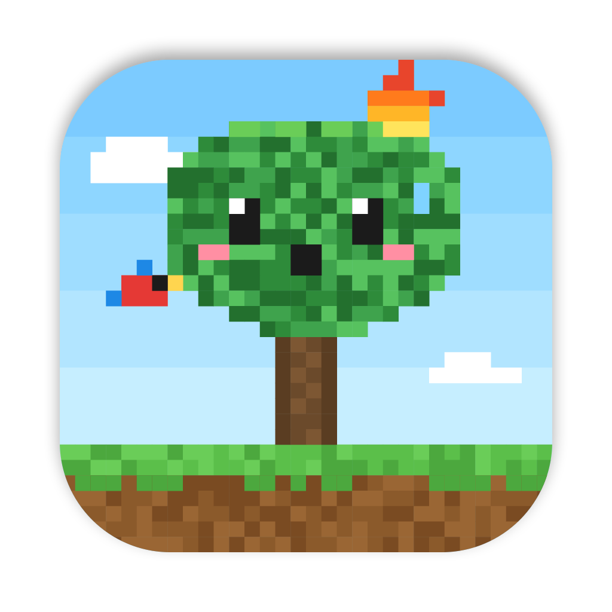

# 🌳🔥 TokensVSRainForest

Eine kleine macOS-Menüleisten-App im Minecraft-Pixel-Stil: Je mehr Tokens du mit deinen
Claude-Code- und Codex-Abos verbrauchst, desto mehr süße Pixel-Regenwaldbäume siehst du verbrennen.

<p align="center">
  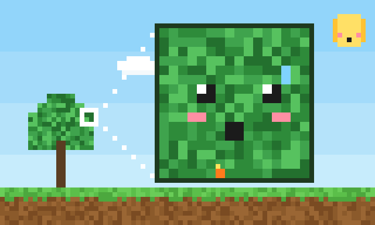
</p>

| Brennender Baum | Zoom auf einen Blatt-Block |
| --- | --- |
| 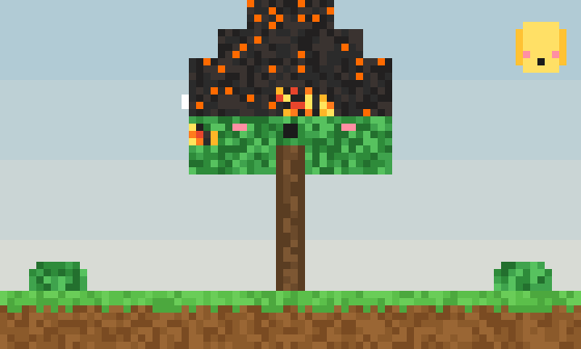 | 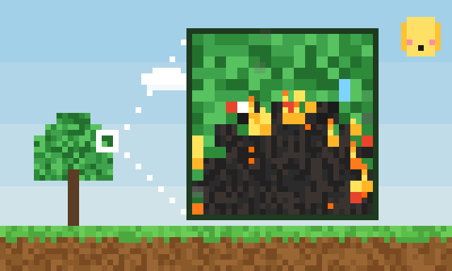 |

| Die App | Quellen & Rechnung |
| --- | --- |
| 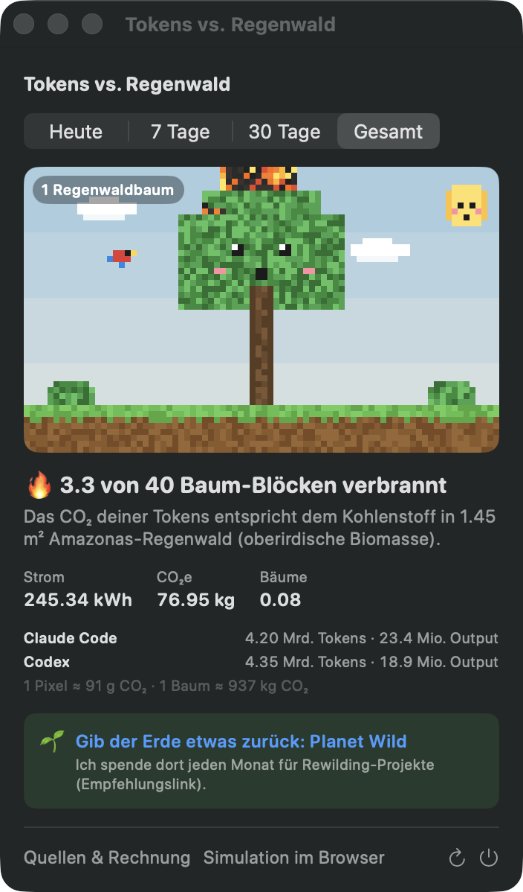 | 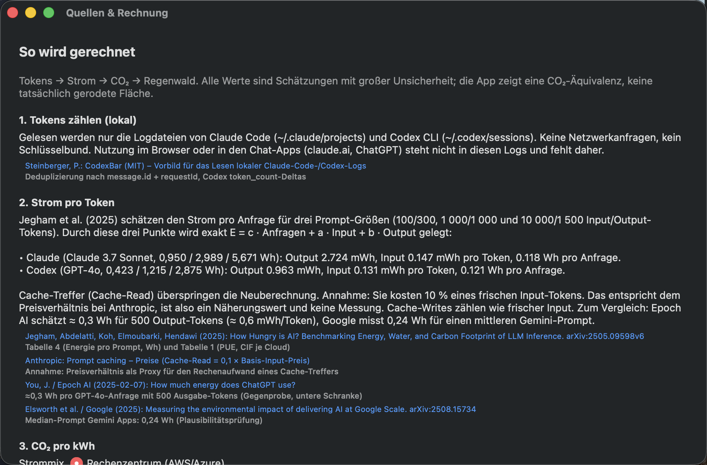 |

<details>
<summary>Alle Zoomstufen als Standbild</summary>

<p>
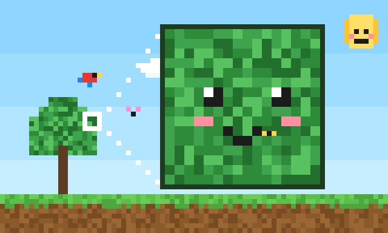
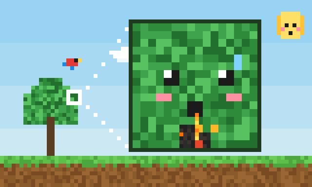
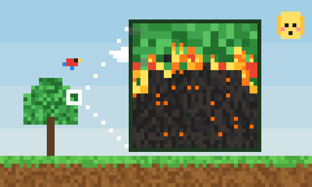
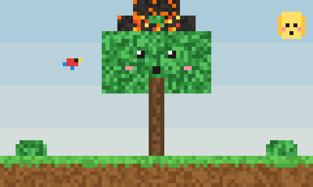
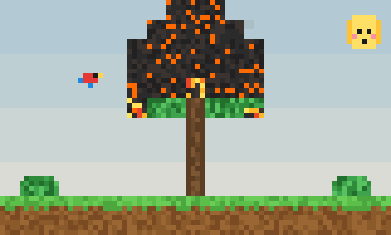
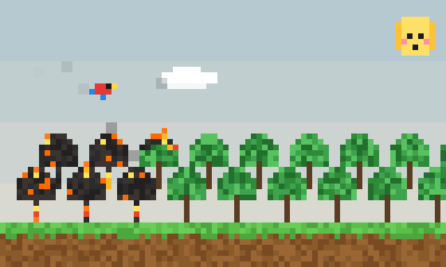
</p>
</details>

## 🌱 Gib der Erde etwas zurück

Ich spende jeden Monat an **[Planet Wild](https://planetwild.com/?code=RRRH33)**. Die Community finanziert damit
Naturschutz- und Rewilding-Projekte. Das macht verbrauchten Strom nicht rückgängig, hilft Wäldern aber ganz real.
Vielleicht magst du mitmachen. *(Empfehlungslink)*

## Web-Simulation: Was wäre, wenn alle so viele Tokens verbrauchen wie du?

`web/index.html` zeigt den ganzen Amazonas-Regenwald als Pixel-Karte (3,9 × 10¹¹ Bäume, ≈ 365 Gt CO₂). Ein Regler
legt fest, wie viele Menschen so viel verbrauchen wie du: nur du, 1 Mio., alle 180 Mio. GitHub-Devs oder alle
8,2 Mrd. Menschen. Das Feuer frisst sich dann vom „Bogen der Abholzung“ aus durch den Wald, im Vergleich zur echten
Abholzung laut PRODES.

<p align="center">
  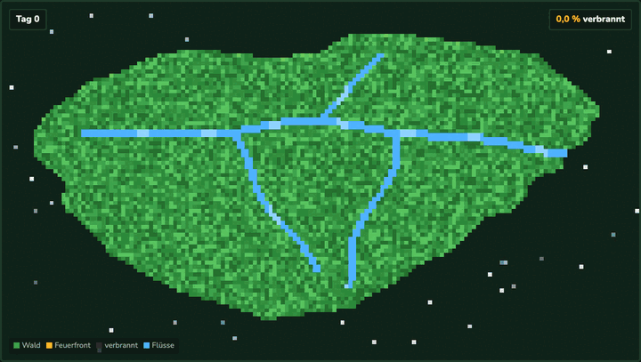
</p>

<details>
<summary>Ganze Seite als Screenshot</summary>

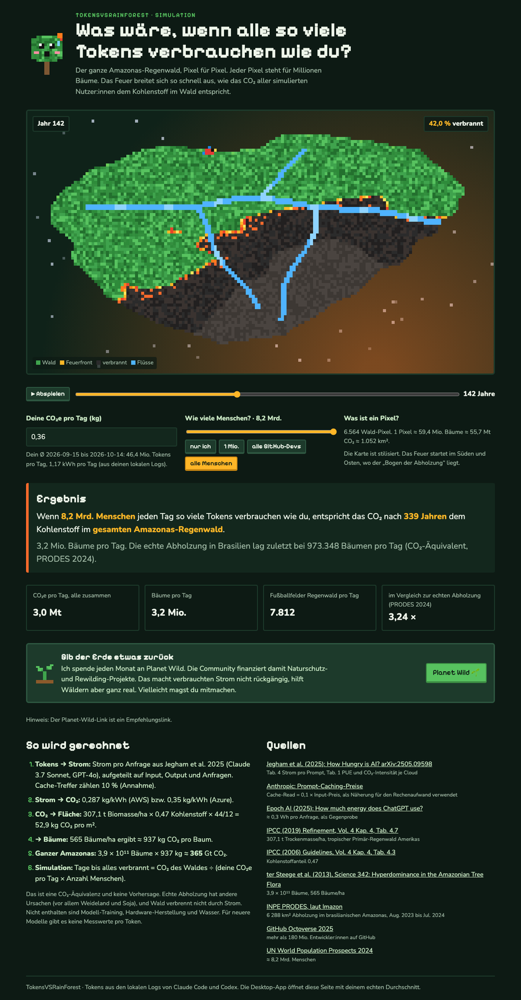
</details>

* In der App: **„Simulation im Browser“** öffnet die Seite mit deinem echten 30-Tage-Durchschnitt.
* Ohne App: `web/index.html` direkt öffnen (mit Beispielwert) oder `swift run rainforest --days 30 --json` für
  die eigenen Werte nutzen.

## Was die App rechnet

Die Rechnung läuft in vier Schritten:

1. **Tokens → Strom.** Grundlage ist der Strom pro Anfrage aus
   [Jegham et al. 2025](https://arxiv.org/abs/2505.09598), Tabelle 4, für Claude 3.7 Sonnet bzw. GPT-4o. Er wird
   auf Input, Output und Anfragen aufgeteilt. Cache-Treffer zählen 10 % eines frischen Input-Tokens; das ist eine
   ausdrücklich gekennzeichnete Annahme.
2. **Strom → CO₂.** 0,287 kg/kWh für AWS (Claude) bzw. 0,35 kg/kWh für Azure (Codex), beide aus Jegham et al.
   Tabelle 1. Alternativ der Welt-Strommix mit 0,458 kg/kWh
   ([Ember 2026](https://ember-energy.org/latest-insights/global-electricity-review-2026/)).
3. **CO₂ → Regenwald.** 307,1 t Biomasse/ha (IPCC 2019, Tab. 4.7) × 0,47 Kohlenstoffanteil (IPCC 2006, Tab. 4.3)
   × 44/12 ergibt **52,9 kg CO₂ pro m²** Amazonas-Regenwald.
4. **→ Bäume und Pixel.** Bei 565 Bäumen/ha ([ter Steege et al. 2013](https://doi.org/10.1126/science.1243092))
   entspricht ein Baum ≈ 937 kg CO₂. Ein Pixel-Baum hat 40 Blöcke à 16 × 16 Pixel, also
   **1 Pixel ≈ 91 g CO₂**.

Die ausführliche Herleitung mit allen Quellen, Tabellen und Grenzen steht in
**[docs/METHODOLOGY.md](docs/METHODOLOGY.md)** und in der App unter „Quellen & Rechnung“.

> Ehrlich bleiben: Die App zeigt eine **CO₂-Äquivalenz**, keine real gerodete Fläche. Ein normaler Tag mit
> Claude Code verbrennt meist nur ein paar Pixel, deshalb zoomt die Szene je nach Menge auf einen Block, einen
> Baum oder einen Wald. Die Zahlen werden nicht künstlich vergrößert.

## Datenquellen (nur lokal)

* Claude Code: `~/.claude/projects/**/*.jsonl` (sowie `~/.config/claude`, `$CLAUDE_CONFIG_DIR`)
* Codex CLI: `~/.codex/sessions` und `archived_sessions` (bzw. `$CODEX_HOME`)

Keine Netzwerkanfragen, kein Schlüsselbund, keine Cookies. Nutzung über claude.ai, ChatGPT oder deren Apps steht
nicht in diesen Logs und wird nicht gezählt.

## Bauen und starten

Voraussetzungen: macOS 14+ und Swift 6.

```bash
./Scripts/package_app.sh          # baut TokensVSRainForest.app (ad-hoc signiert)
open TokensVSRainForest.app

swift run rainforest              # CLI: heute, mit allen Zwischenwerten
swift run rainforest --days 30    # letzte 30 Tage
swift run rainforest --all --global-grid
swift run rainforest --sources    # alle Quellen
swift run rainforest --days 30 --json   # Tagesdurchschnitt für die Web-Simulation
swift Scripts/make_icon.swift Resources/AppIcon.png   # Icon neu zeichnen
./Scripts/make_gifs.sh            # GIFs für das README neu rendern (ImageMagick + Chrome)

swift test                        # Methodik- und Parser-Tests
```

Bei vollen Menüleisten auf MacBooks mit Notch kann das Icon hinter der Notch verschwinden. Ein Menüleisten-Manager
wie Ice oder Bartender hilft.

## Projektaufbau

| Pfad | Inhalt |
| --- | --- |
| `Sources/RainforestCore/Methodology.swift` | alle Konstanten und Quellen |
| `Sources/RainforestCore/*LogParser.swift`, `UsageLoader.swift` | Einlesen der lokalen Logs |
| `Sources/RainforestCore/ImpactCalculator.swift` | Tokens → Wh → kg CO₂ → m², Bäume, Blöcke, Pixel |
| `Sources/TokensVSRainForest/PixelScene.swift` | animierte Pixel-Szene (SwiftUI `Canvas` + `TimelineView`) |
| `Sources/rainforest` | CLI |

## Danke

Die Idee, lokale Claude-Code- und Codex-Logs auszuwerten, stammt aus
[CodexBar](https://github.com/steipete/CodexBar) von Peter Steinberger (MIT). TokensVSRainForest ist eine
eigenständige, schlanke Neu-Implementierung dieser Idee.

## Lizenz

MIT, siehe [LICENSE](LICENSE).
